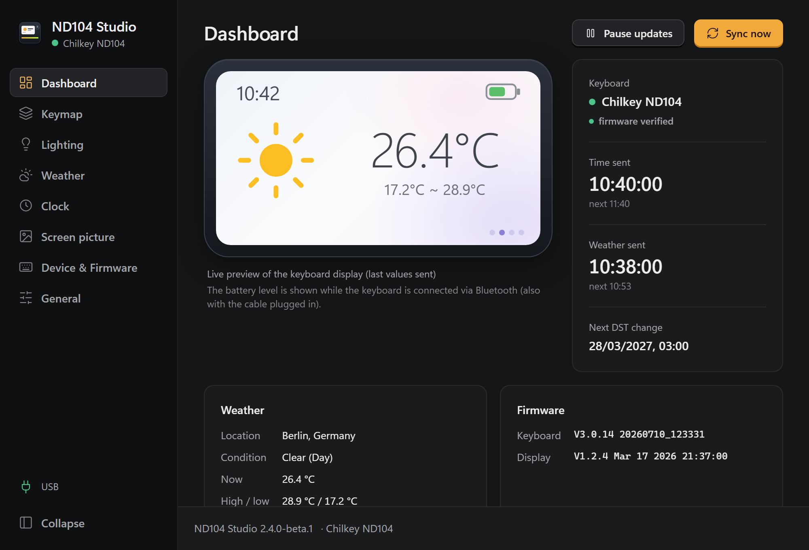

# Chilkey ND104 Utilities

Tools for the **Chilkey ND104** keyboard and its built-in 1.47" display,
without the vendor software. Time, weather or your own picture on the display,
lighting, keymap, and a heads-up when new firmware is out.

> [!WARNING]
> **Unofficial hobby project, use at your own risk.** No warranty, no
> guaranteed support, not affiliated with Chilkey. Only tested with the
> firmware versions listed below. Please read the [disclaimer](#disclaimer)
> before you use any tool.

## Tools

<!--
  One block per tool. To add a tool, copy the table below and replace
  screenshot, name, description, badges and links.
  Screenshot: about 360 px wide, stored in docs/images/<tool>/.
-->

<table>
  <tr>
    <td width="380" valign="top">
      
    </td>
    <td valign="top">
      <h3><a href="apps/nd104-studio/README.md">ND104 Studio</a></h3>
      

        Everything for the ND104 in one small tray app. Set it up once, then
        forget it. <i>Formerly nd104-sync.</i>
      

      

        🕒 Time sync: time zones, NTP, summer/winter time 
        🌦️ Weather: 5 providers, 2 without API key 
        🖼️ Own picture or GIF on the screen 
        💡 Lighting, plus OpenRGB and SignalRGB 
        ⌨️ Keymap: keys, knob, round button, profiles 
        📶 USB, Bluetooth and 2.4 GHz 
        🛡️ Firmware safety lock and update notice 
        🔄 One-click app updates
      

      

        
        
        
      

      

        📖 <a href="apps/nd104-studio/README.md">Documentation</a> ·
        ⬇️ <a href="https://github.com/MrUrdam/chilkey_nd104_utilities/releases">Download</a> ·
        📝 <a href="apps/nd104-studio/CHANGELOG.md">Changelog</a>
      

    </td>
  </tr>
</table>

## The keyboard

The [Chilkey ND104](https://chilkey.com/products/nd104-keyboard) is a full-size
keyboard (104 keys) with an aluminium case, hot-swap sockets, a rotary knob and
a 1.47" colour display (320 × 172).

- 📶 **Connection:** USB-C, 2.4 GHz, Bluetooth 5.4. What works on which:
  [Connection modes](apps/nd104-studio/README.md#connection-modes)
- 🌐 **Official software:** [web driver](https://nd104.chilkey.com/) (WebHID,
  Chromium-based browsers only) and [console / downloads](https://chilkey.com/pages/console)
- ❓ **Support & FAQ:** [ND104 Support & Resources](https://chilkey.com/blogs/updates/nd104-faq-resources)

<b>Hardware (from community reverse engineering)</b>

| Component | Chip / info | USB VID:PID |
|---|---|---|
| Keyboard MCU | WCH CH585 (RISC-V, BLE) | `6d67:016c` |
| 2.4 GHz receiver | – | `6d66:8572` |
| Display controller | U-BEST UB32F341S (ARM, RTX + LVGL) | `5542:0001` |
| Display in DFU mode | – | `5542:1000` |

Details: [docs/protocol.md](docs/protocol.md).

## Firmware

| Part | Tested with | |
|---|---|:-:|
| Keyboard | **V3.0.14** (`20260710_123331`) | ✅ |
| Screen, 24 h / °C | **V1.2.4** (`Mar 17 2026 21:37:00`) | ✅ |
| Screen, 12 h / °F | V1.2.2 (newest file) | not tested |

Other versions may work, but nobody has checked them (see [disclaimer](#disclaimer)).
ND104 Studio tells you when Chilkey publishes newer firmware.

<b>Where the newest firmware comes from, and how to read your version</b>

| Part | Support page says | Newest file on Chilkey's Drive (read 2026-10-31) |
|---|---|---|
| Keyboard | V3.0.4 | `VN001_314A108_1V0_RGB_TYPE1_20260710.bin` (2026-07-10) |
| Screen, 24 h / °C | V1.2.1 | MCU `…_V1.0.0_20260317.bin`, UI `…_V1.0.0_20251104.bin` |
| Screen, 12 h / °F | V1.2.1 | MCU `…_CF_…_V1.0.0_20260305.bin`, UI `…_V1.0.0_20251230.bin` |

The support page text is outdated. The newest firmware is only visible through
the file names in Chilkey's Google Drive folders. Details and links:
[docs/firmware.md](docs/firmware.md).

The installed versions are shown in ND104 Studio (**Device & Firmware**) and
read with `nd104-probe version`
([nd104-probe](apps/nd104-studio/crates/nd104-probe/README.md)). The
[web driver](https://nd104.chilkey.com/) info dialog shows them too, but its
screen version is often wrong, see
[docs/protocol.md § 3.3](docs/protocol.md#33-why-the-screen-version-looks-broken-on-the-web-driver).

## Repository & documentation

| Where | What |
|---|---|
| 🧰 [`apps/nd104-studio`](apps/nd104-studio/README.md) | ND104 Studio: features, install, usage, building |
| 🔬 [`nd104-probe`](apps/nd104-studio/crates/nd104-probe/README.md) | Diagnostic CLI: read firmware versions, test packets |
| 📡 [docs/protocol.md](docs/protocol.md) | HID protocol over USB, Bluetooth and 2.4 GHz |
| 🧩 [docs/keyboard-api.md](docs/keyboard-api.md) | What the ND104 can do, and what ND104 Studio uses |
| 💾 [docs/firmware.md](docs/firmware.md) | Where the newest firmware really comes from, screen variants (°C / °F) |
| 🐧 [docs/linux-port.md](docs/linux-port.md) | How the Linux version was built and tested |
| 👀 [`firmware/`](firmware/README.md) | Firmware version list and the daily firmware watcher (no vendor binaries) |
| 🛠️ `scripts/` | Small scripts and experiments for display and keyboard |
| 🖼️ `assets/`, `docs/images/` | Pictures and GIFs for the display (320 × 172), screenshots |

## Disclaimer

**Unofficial project.** This repository is a private hobby project. It is not
affiliated with, endorsed by or supported by Chilkey. "Chilkey" and "ND104" are
names of their respective owners and are used here only to describe what the
tools work with.

**Use at your own risk.** All tools, scripts and information in this repository
are provided "as is". Sending data to the keyboard over USB and, above all,
flashing firmware can make the keyboard or its display unusable and may void
your warranty. You decide what you run on your hardware, and you carry the
risk.

**No warranty, no liability.** The software comes without any warranty, as
stated in the [MIT license](LICENSE). The authors are not liable for damage to
hardware, loss of data or any other harm caused by using it.

**Limited scope.** The tools are only tested with:
- the Chilkey ND104,
- the connections and features marked ✅ in [Connection modes](apps/nd104-studio/README.md#connection-modes),
- the firmware versions marked ✅ in [Firmware](#firmware),
- the platforms named in each tool's README (ND104 Studio: Windows 10/11 and
  Linux x86-64 – tested on Ubuntu 24.04, packages install-tested on Debian,
  Ubuntu, Fedora, openSUSE and Arch; see its [Platform support](apps/nd104-studio/README.md#platform-support)).

Everything else may work, but is untested. ND104 Studio has a safety lock that
stops sending as soon as the keyboard behaves differently from what was tested,
but that is a precaution, not a promise.

**No guaranteed support.** Issues and pull requests are welcome. I answer them
in my free time, when and if I can. There is no promise of fixes, updates or
answers. For problems with the keyboard itself, please contact
[Chilkey support](https://chilkey.com/blogs/updates/nd104-faq-resources).

## Sources & credits

- [ND104 Reverse Engineering](https://gist.github.com/borrougagnou/a21613093f323a05167a92212ab1ff7b) by borrougagnou
- [ND104 Firmware Upgrade Guide](https://gist.github.com/borrougagnou/ab98c68cb6812d76fc0357e57f8541d9) by borrougagnou
- Official [Chilkey web driver](https://nd104.chilkey.com/), analysed for the version queries
- [zoom-sync](https://github.com/ozboar/zoom-sync), a model for weather and time sync
- Weather and place data: Open-Meteo, Deutscher Wetterdienst (via Bright Sky),
  OpenWeather, WeatherAPI.com and GeoNames. Licences and required credits:
  [ND104 Studio → Weather providers](apps/nd104-studio/docs/usage.md#weather-providers)

## License

MIT, see [LICENSE](LICENSE). ND104 Studio contains third-party open-source
software under its own licences, listed in
[THIRD-PARTY-NOTICES.txt](apps/nd104-studio/THIRD-PARTY-NOTICES.txt).
