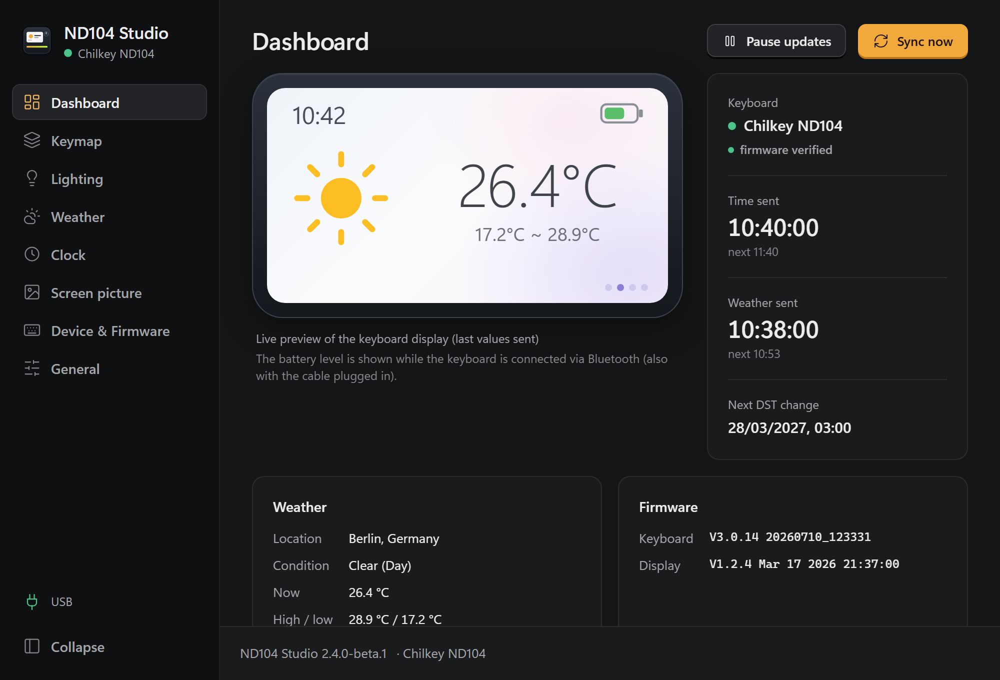
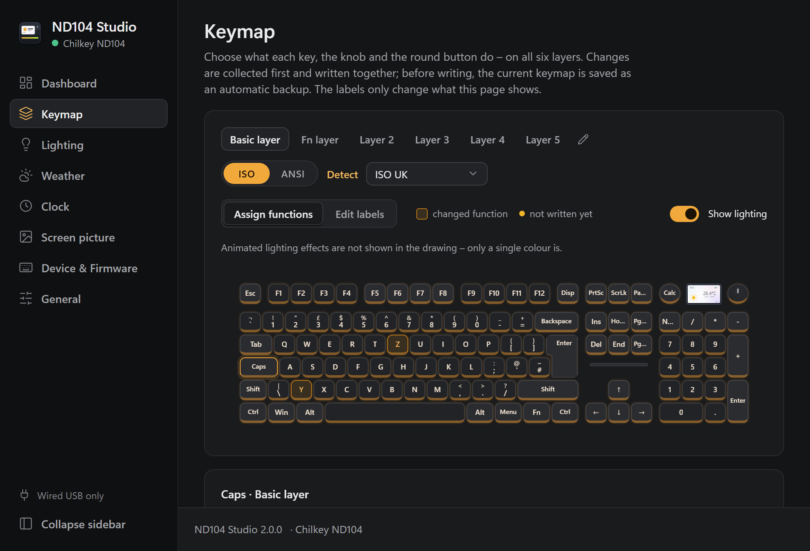
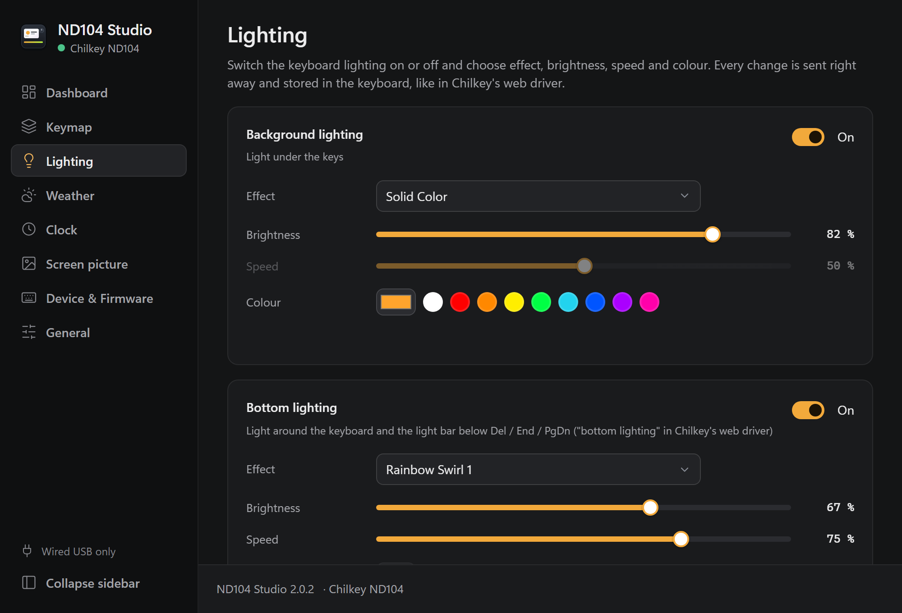
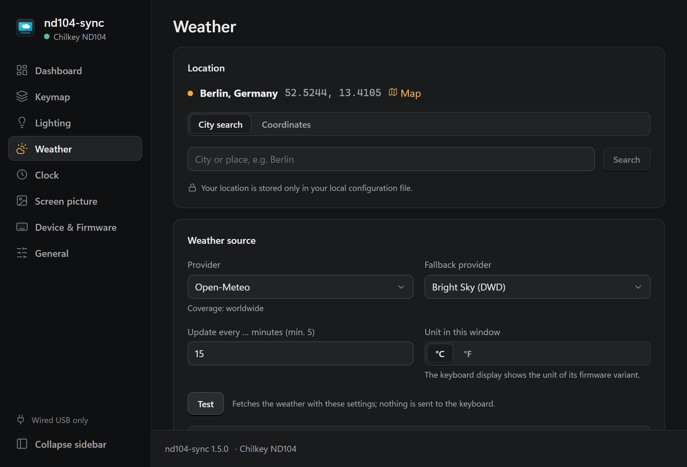
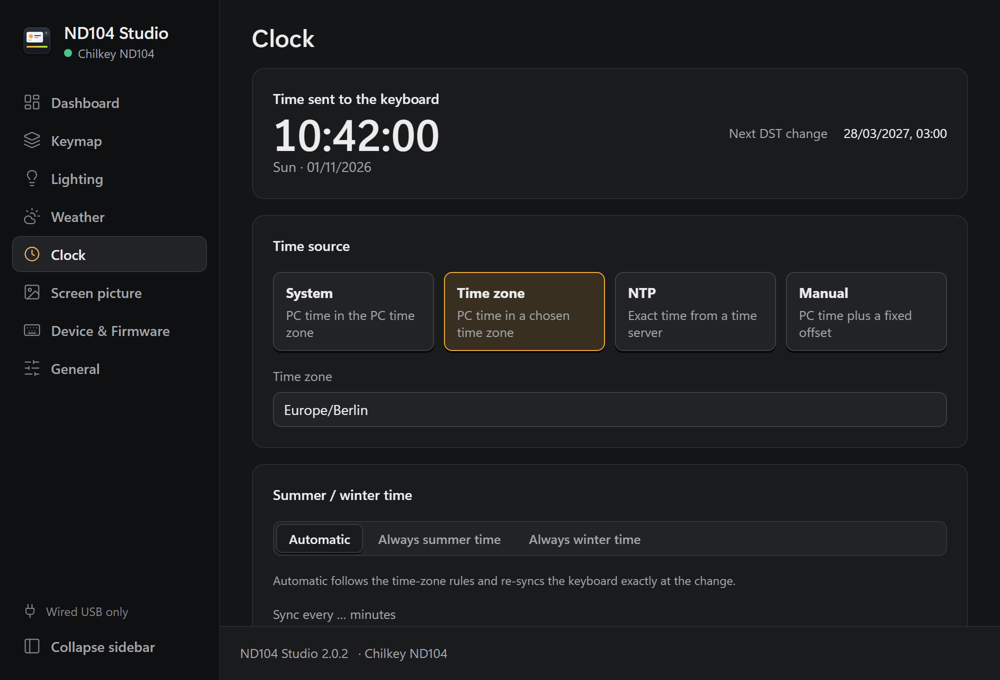
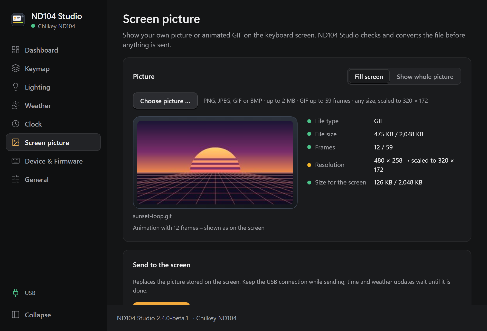
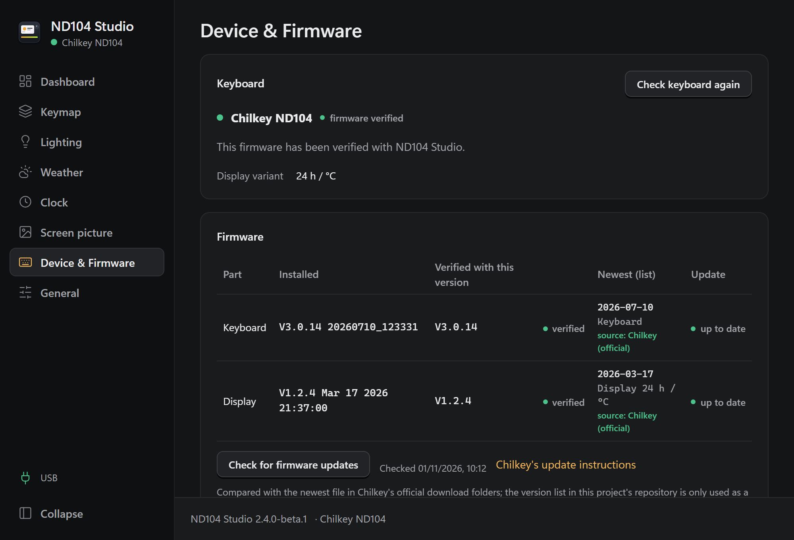
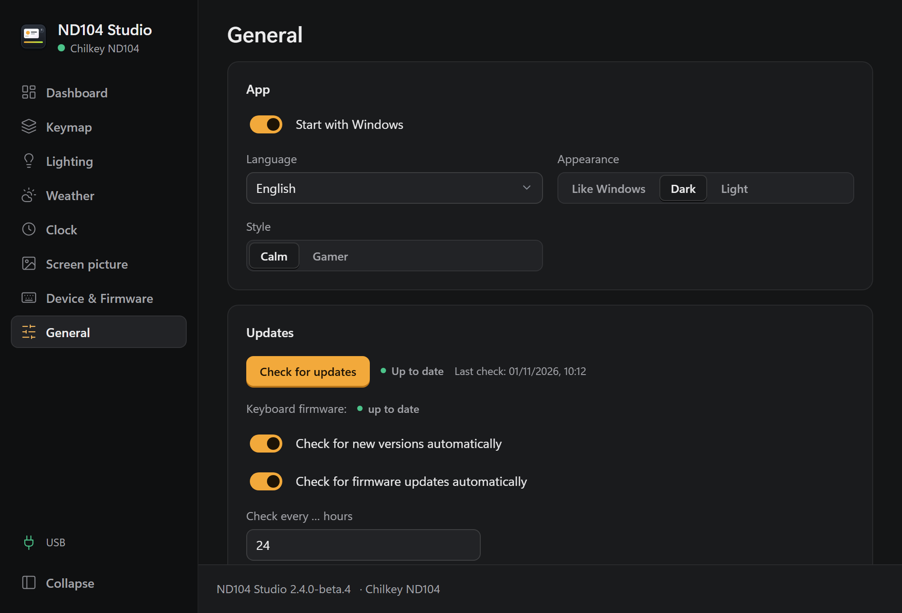

# ND104 Studio

-FCC624?logo=linux&logoColor=black)

 

Everything for the **Chilkey ND104** keyboard in one small tray app: it keeps
the display up to date with the **current time and weather**, shows **your
own picture or GIF**, sets the **lighting** and lets you **remap keys, the
knob and the round button** on all layers. Set it up once, then forget it.

*Formerly **nd104-sync**. Updating from nd104-sync 1.x takes everything over
– see [Coming from nd104-sync](docs/installation.md#coming-from-nd104-sync).*

  

<!-- page order as in the sidebar -->
<table>
  <tr>
    <td align="center"> Keymap: layers, ISO/ANSI, labels, keys, knob and round button</td>
    <td align="center"> Lighting: on/off, effect, brightness, speed, colour, PC lighting software</td>
  </tr>
  <tr>
    <td align="center"> Weather: provider, location search, test</td>
    <td align="center"> Clock: source, time zone, summer/winter time</td>
  </tr>
  <tr>
    <td align="center"> Screen picture: checks, animated preview, send</td>
    <td align="center"> Device & Firmware: safety state, update check</td>
  </tr>
  <tr>
    <td align="center"> General: autostart, language, theme, style, updates</td>
  </tr>
</table>

**⬇️ [Download](https://github.com/MrUrdam/chilkey_nd104_utilities/releases)** ·
[Install](docs/installation.md) · [Usage](docs/usage.md) · [Changelog](CHANGELOG.md)

> ⚠️ **Use at your own risk.** Unofficial hobby project, not affiliated with
> Chilkey. No warranty and no guaranteed support. Only tested with the
> firmware versions listed under [Supported firmware](docs/firmware-safety.md#supported-firmware),
> on Windows 10/11 and Linux (beta), with the connections marked ✅ in
> [Connection modes](#connection-modes). Full text: [disclaimer](../../README.md#disclaimer).

---

## Documentation

| Guide | What's in it |
|---|---|
| **[Installation & updating](docs/installation.md)** | Windows (setup, MSI, portable) and Linux (`.deb`, `.rpm`, AppImage, tarball); the udev access rule; how each install type updates |
| **[Usage & reference](docs/usage.md)** | Settings window, console runner `nd104-cli`, PC-lighting setup, key combinations, files, weather providers, clock sources |
| **[Firmware: safety & updates](docs/firmware-safety.md)** | Supported versions, the firmware safety lock, the firmware update check |
| **[Building from source](docs/building.md)** | Prerequisites and build on Windows & Linux, the release pipeline, dependencies, project layout |
| **[Troubleshooting & privacy](docs/troubleshooting.md)** | Common problems and fixes; what the app connects to |
| **[Changelog](CHANGELOG.md)** | Changes per version |

**On this page:** [Why](#why) · [Features](#features) ·
[Connection modes](#connection-modes) · [Platform support](#platform-support) ·
[PC lighting software](#pc-lighting-software-openrgb-signalrgb) ·
[What it does NOT do](#what-it-does-not-do) · [Requirements](#requirements) ·
[Install](#install) · [Versioning](#versioning) ·
[Contributing](#contributing) · [Credits](#credits)

---

## Why?

The ND104 has no internet connection. Its display can show time and weather,
but only if a connected PC sends that information. The official solution is a
browser-based driver plus a weather plugin with a fixed weather backend.
ND104 Studio replaces this with a small background app that you configure
once – your weather provider, your location, your clock source – and adds
what you would otherwise open the web driver for: lighting, your own screen
picture and the keymap.

## Features

**Display**
- **Syncs the clock** regularly, on connect, after sleep and exactly at
  summer/winter time changes; sources: **system, time zone, NTP or manual
  offset**, with automatic or forced DST
- **Fetches the weather** for your location (current, max, min + condition
  icon) from **five providers** (two without API key), with a fallback and a
  city search
- **Own picture or GIF** on the screen: any PNG/JPEG/GIF/BMP is checked and
  scaled to 320 × 172 before sending

**Keymap**
- **Remap keys, the knob and the round button** on all 6 layers; changes are
  collected, reviewed and written together (only the differences), then read
  back to verify
- **Automatic backup** before every write (last 20 kept) plus manual
  backup/restore to a file; **profiles** (save, load, export, import)
- **ISO or ANSI** drawing with detection, several **label sets**, renamable
  layers; pressed keys and the single-colour lighting light up in the drawing,
  next to the **live screen**

**Lighting and keyboard settings**
- **Background and bottom lighting** (on/off, effect, brightness, speed,
  colour) – sent and stored in the keyboard right away
- **Keyboard settings** (debounce mode/time, sleep and deep-sleep time) with
  exactly the values Chilkey's web driver offers
- **Per-key colours from PC lighting programs** (OpenRGB, Artemis, Aurora;
  SignalRGB on Windows) – see [PC lighting software](#pc-lighting-software-openrgb-signalrgb)

**Safety and updates**
- **Firmware safety lock:** works with older/newer firmware too, but stops the
  moment the protocol behaves differently
  (see [Firmware safety](docs/firmware-safety.md#firmware-safety)); answers
  meant for other programs are ignored
- **Shows the installed firmware** and **checks for firmware updates** against
  Chilkey's official folders (never downloads or flashes anything)
- **Checks for new ND104 Studio releases** and installs them with one click
  (setup / AppImage) – see [Updating](docs/installation.md#updating)

**App**
- Starts at login and lives in the **system tray**; **status dashboard** with a
  live preview of the display
- API keys in the **OS credential store** (Windows Credential Manager / Linux
  Secret Service)
- UI in **English and German**, **two styles** (Calm / Gamer) each in dark and
  light, collapsible sidebar
- **Console runner** `nd104-cli` for scripting and testing
- **No telemetry** (see [Privacy](docs/troubleshooting.md#privacy--network-access))

## Connection modes

The ND104 connects by USB cable, Bluetooth (3 devices) or 2.4 GHz receiver.
**This table is the one place that says what works on which connection** –
the rest of the documentation, the app and the setup point here.

| Feature | USB cable | Bluetooth | 2.4 GHz |
|---|:-:|:-:|:-:|
| Time and weather on the display | ✅ | ✅ | ✅ |
| Own picture or GIF on the screen | ✅ | ❌ | ❌ |
| Lighting | ✅ | ✅ | ✅ |
| Per-key colours from PC lighting programs – OpenRGB, Artemis, Aurora, SignalRGB ([PC lighting software](#pc-lighting-software-openrgb-signalrgb)) | ✅ | ❌ | ❌ |
| Keymap (remap, backup, profiles, pressed keys in the drawing) | ✅ | ✅ | ✅ |
| Keyboard settings (debounce, sleep times) | ✅ | ✅ | ✅ |
| Keyboard firmware version and firmware update check | ✅ | ✅ | ☑️ ¹ |
| Screen firmware version | ✅ | ☑️ ¹ | ☑️ ¹ |
| Battery level (app and live preview) | ☑️ ² | ✅ | ❌ |
| App updates, weather download, settings window | ✅ | ✅ | ✅ |

✅ works · ☑️ with a limitation (footnote) · ❌ not available

¹ Taken from the last USB connection (the keyboard version also from the last
Bluetooth connection). **Connect the keyboard once by cable** first; until
then ND104 Studio waits ("Connecting …") and says so – it does not lock.
² Over the cable itself the keyboard does not report its battery level; it is
shown as long as the keyboard is also connected via Bluetooth.

- **Priority:** with several connections at once, ND104 Studio uses the
  cable first, then Bluetooth, then 2.4 GHz (and still shows the battery
  level from Bluetooth). Switching to a higher one also ends a lock that
  happened on the lower one – all checks run again.
- **Sleep and off:** when the keyboard sleeps, Windows drops the Bluetooth
  link; over 2.4 GHz the receiver stays but the keyboard stops answering.
  Either way ND104 Studio shows "Not connected" / "Connecting …" and connects
  again as soon as the keyboard answers (press a key) – no lock; only a wrong
  answer locks, like over USB.
- The sidebar shows the current mode in green ("USB", "Bluetooth",
  "2.4 GHz"), the tray status line adds "(Bluetooth)" or "(2.4 GHz)".
- **How it works:** over Bluetooth the keyboard offers the same command
  channel as over USB (HID over Bluetooth LE, one extra report ID byte); the
  2.4 GHz receiver offers it too and forwards every command over the air. In
  both cases the keyboard passes time and weather on to the screen as it
  does over the cable. The screen controller itself is a second USB device
  inside the keyboard and reachable by cable only – hence picture and
  screen version need the cable; over 2.4 GHz the version query reaches only
  the receiver. Details: [protocol.md § 5.5](../../docs/protocol.md#55-over-bluetooth-analysis-2026-11-02)
  and [§ 5.6](../../docs/protocol.md#56-over-the-24-ghz-receiver-analysis-2026-11-02).

The same overview is in the app: **Device → Connection modes**.

## Platform support

ND104 Studio runs on **Windows 10/11** and, from 2.4.0, on **Linux (beta)**
([plan](../../docs/linux-port.md)). This table is the one place that says what
differs between them – everything else (time and weather, own picture,
lighting, keymap, settings, the connection modes above) works the same.

| Feature | Windows 10/11 | Linux (beta) |
|---|:-:|:-:|
| OpenRGB interface (OpenRGB, Artemis …) | ✅ | ✅ |
| SignalRGB plugin | ✅ | ❌ ¹ |
| Tray icon | ✅ | ☑️ ² |
| Start at login | ✅ | ✅ |
| API keys in the system's secure store | ✅ Credential Manager | ✅ Secret Service (GNOME Keyring, KWallet) |
| Keyboard access without admin rights | ✅ | ☑️ ³ |
| Bluetooth connection and battery | ✅ | ✅ (BlueZ) |
| Updates from within the app | ✅ | ☑️ ⁴ |

✅ works · ☑️ with a limitation (footnote) · ❌ not available

¹ SignalRGB (and Aurora) exist for Windows only; on Linux use the OpenRGB
interface.
² GNOME shows tray icons only with the AppIndicator extension (preinstalled
on Ubuntu); on Linux a click opens the menu and there is no tooltip.
ND104 Studio can also be opened from the app menu.
³ Needs the udev rule (the `.deb`/`.rpm` install it) – see
[Installation → the udev rule](docs/installation.md#keyboard-access--the-udev-rule).
⁴ The AppImage updates itself; `.deb`/`.rpm` packages are updated by the
system's package manager – see [Updating](docs/installation.md#updating).

The same overview is in the app: **Device → Operating systems**.

## PC lighting software (OpenRGB, SignalRGB)

Besides its own effects, the ND104 can let a lighting program on the PC
colour every LED individually: 130 LEDs – the keys, the light bar under
Del / End / Page Down and the edge glow. USB cable only (the lighting channel
is not available over Bluetooth or 2.4 GHz).

| Program | Works with the ND104 |
|---|---|
| **OpenRGB** | ✅ through ND104 Studio's OpenRGB interface (as an SDK client) |
| **Artemis**, **Aurora** and other OpenRGB SDK programs | ✅ through ND104 Studio's OpenRGB interface |
| **SignalRGB** (Windows only) | ✅ with the plugin from ND104 Studio |
| OpenRGB on its own (device detection) | ❌ it talks to the keyboard's VIA channel, not its lighting channel |
| Windows Dynamic Lighting | ❌ the keyboard does not answer Windows' lighting request (firmware V3.0.14) |

Switch it on with **Lighting → PC lighting software → *Allowed*** (or
Fn + Shift + L on the keyboard). **Setup steps** (OpenRGB interface, SignalRGB
plugin) are in [Usage → PC lighting software](docs/usage.md#pc-lighting-software--setup).

## What it does NOT do

- ❌ **Not every feature on every connection** – see
  [Connection modes](#connection-modes).
- ❌ **No macOS support.** Windows 10/11 and Linux (beta) only.
- ❌ **No firmware flashing.** It never downloads, installs or modifies firmware.
  It only tells you an update exists.
- ❌ **No risky communication.** Everything is sent only while every protocol
  check passes; if anything looks different, the tool stops immediately and
  tells you why. There is no "ignore and continue" switch.
- ❌ **No macros.** Recording or editing macros stays with the official
  [Chilkey driver](https://chilkey.com/pages/console); keymap backups and
  profiles do not contain them.
- ❌ **No tap/hold or combo editor.** Keys get any single function; existing
  combinations are shown and kept, but not created.
- ❌ **No key swapping or automatic profile switching.** Profiles are loaded by
  hand (every switch would wear the keyboard's memory).
- ❌ **No "Online RGB", keyboard colour or USB polling rate.** "Online RGB" only
  decides whether PC lighting programs may take over the LEDs, and keyboard
  colour is stored but not used by the firmware (see
  [protocol.md § 5.2.1](../../docs/protocol.md#521-what-the-firmware-does-with-each-id-v3014)).
- ❌ **No display themes**, and **no °C/°F or 12/24 h switching on the display**:
  Chilkey ships two screen firmware variants with the unit and time format
  fixed at build time; the keyboard converts the °C values and 24 h time it
  receives itself (see [docs/firmware.md](../../docs/firmware.md)).
- ❌ **No other keyboard models.** Only the Chilkey ND104 is supported, though
  the code has a model interface (`KeyboardModel` in
  [`crates/nd104-core/src/model/mod.rs`](crates/nd104-core/src/model/mod.rs)).
- ❌ **Not meant to run alongside** the official Chilkey weather plugin, and
  don't change the keymap in Chilkey's web driver while ND104 Studio writes one.

---

## Requirements

| | |
|---|---|
| OS | Windows 10 (21H2+) / Windows 11 (64-bit), or Linux (x86-64, glibc 2.35+: Ubuntu 22.04+, Debian 12+, Fedora 41+, openSUSE …) |
| Connection | Chilkey ND104, connected as listed in [Connection modes](#connection-modes) |
| Firmware | Verified versions, or others while the protocol checks pass (see [Firmware: safety & updates](docs/firmware-safety.md)) |
| Runtime | **Windows:** Microsoft Edge WebView2 (pre-installed on Windows 11 and current Windows 10). **Linux:** WebKitGTK 4.1 + an AppIndicator tray host – the `.deb`/`.rpm` pull these in |

## Install

Download the newest [release](https://github.com/MrUrdam/chilkey_nd104_utilities/releases),
then:

- **Windows:** run `nd104-studio_X.Y.Z_x64-setup.exe` (recommended), or use the
  MSI / portable zip.
- **Linux:** `sudo apt install ./nd104-studio_X.Y.Z_amd64.deb` (Debian/Ubuntu),
  the `.rpm` (Fedora/openSUSE), or the portable, self-updating **AppImage**.
  The `.deb`/`.rpm` install the udev access rule.

Full steps per platform, the udev rule, and updating:
**[Installation & updating](docs/installation.md)**.

## Versioning

- ND104 Studio uses [Semantic Versioning](https://semver.org/): `MAJOR.MINOR.PATCH`.
  MAJOR = incompatible changes, MINOR = new features, PATCH = fixes.
- **One source of truth:** `version` in [`Cargo.toml`](Cargo.toml)
  (`[workspace.package]`). Every crate, the CLI (`nd104-cli --version`) and the
  app UI read it from there.
- **Release tags:** `nd104-studio-vX.Y.Z` (up to 1.5.0: `nd104-sync-vX.Y.Z`).
  The prefix is needed because this repository hosts several tools.
- **Changes:** listed per version in [CHANGELOG.md](CHANGELOG.md).

## Contributing

- **New weather provider:** implement the `WeatherProvider` trait, register it,
  add locale strings and a row in the provider table.
- **New language:** add `locales/<code>.json` with all keys of `en.json`.
- **New firmware version:** verify the protocol on real hardware, document it in
  `docs/protocol.md`, add it to the verified list.

Contributions are welcome, but reviews and answers happen in my free time.
There is no guaranteed support (see the [disclaimer](../../README.md#disclaimer)).
Build instructions: [Building from source](docs/building.md).

## Credits

Protocol knowledge is based on the
[ND104 reverse engineering notes](https://gist.github.com/borrougagnou/a21613093f323a05167a92212ab1ff7b)
by borrougagnou and on an analysis of the official
[Chilkey web driver](https://nd104.chilkey.com/). Everything is collected in
[docs/protocol.md](../../docs/protocol.md). Inspired by
[zoom-sync](https://github.com/ozboar/zoom-sync).

**Third-party software:** ND104 Studio is built with open-source packages –
Rust crates (Tauri, hidapi, serde, reqwest …), Svelte, the
[Rajdhani](https://fonts.google.com/specimen/Rajdhani) font (SIL Open Font
License 1.1) and icon shapes from [Lucide](https://lucide.dev) (ISC). Their
licences are listed in [THIRD-PARTY-NOTICES.txt](THIRD-PARTY-NOTICES.txt),
which ships with every release and is shown in the app under **General →
About → Open-source licences**. It is generated by
[`scripts/third_party_notices.py`](scripts/third_party_notices.py); CI checks
that it is up to date (run the script after changing dependencies).

**Data:** see [Weather providers](docs/usage.md#weather-providers) for the data
sources and the credits they require.

Unofficial project, not affiliated with or endorsed by Chilkey. "Chilkey"
and "ND104" are names of their respective owners and are used only to say
which keyboard the app works with. Use at your own risk, see the
[disclaimer](../../README.md#disclaimer). MIT licensed, see [LICENSE](../../LICENSE).
