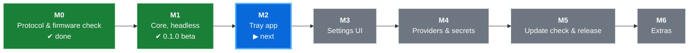

# nd104-sync

Background tool that keeps the display of the **Chilkey ND104** keyboard up to
date with the **current time and weather** – with a tray icon and a modern
settings/status window.

> 🚧 **Status: beta 0.1.0 (milestone M1).** The tray app does not exist yet.
> The core works and can already be used on the console with
> [`nd104-cli`](#console-runner-nd104-cli-available-now) – download it from the
> [releases](https://github.com/MrUrdam/chilkey_nd104_utilities/releases). See the
> [roadmap](#roadmap) and the [changelog](CHANGELOG.md).

> 🔌 **Wired USB only.** nd104-sync only supports the keyboard connected with a
> **USB cable**. 2.4 GHz dongle and Bluetooth modes are **not supported** and
> not tested.

> 🪟 **Windows only (for now).** Windows 10/11 is the only supported platform.
> The architecture is prepared for Linux and macOS, but support is not
> implemented.

---

## Why?

The ND104 has no internet connection. Its display can show time and weather,
but only if a connected PC sends that information. The official solution is a
browser-based driver plus a weather plugin with a fixed weather backend.
nd104-sync replaces this with a small background app that you configure once:
your weather provider, your location, your clock source.

## What it does

- Starts with Windows and lives in the **system tray**
- **Syncs the clock** to the keyboard regularly, on connect, after sleep and
  exactly at summer/winter time changes
- **Fetches the weather** for your location and sends current, max and min
  temperature plus a condition icon to the display
- Lets you choose the **weather provider**, **location**, **clock source**,
  **time zone** and **DST mode** in a settings window
- Shows a **status dashboard** with a live preview of what the display shows
- **Protects your keyboard:** works with older/newer firmware too, but stops
  immediately as soon as the protocol behaves differently
  (see [Firmware safety](#firmware-safety))
- **Shows the installed firmware** of keyboard and screen (dashboard and
  Device & Firmware page)
- **Checks for firmware updates** after boot and notifies you; manual
  **"Check for updates"** button in the UI and in the tray menu
- **Checks for new nd104-sync releases** on GitHub after boot and on demand
  (see [Updating](#updating))
- **Shows its version** in the settings window (General → About), in the
  dashboard footer and in the tray tooltip
- UI in **German and English** (follows the system language, switchable)
- **Dark / light mode** following Windows, overridable in settings

## What it does NOT do

- ❌ **No wireless support** – no 2.4 GHz dongle, no Bluetooth. USB cable only.
- ❌ **No Linux / macOS support** yet (possible in the future, not implemented).
- ❌ **No firmware flashing.** It never downloads, installs or modifies firmware;
  it only tells you an update exists.
- ❌ **No risky communication.** On firmware that isn't verified, only time and
  weather are sent, and only while every protocol check passes. If anything
  looks different, the tool stops sending immediately and tells you why. There
  is no "ignore and continue" switch.
- ❌ **No keyboard configuration** – keymap, RGB lighting, macros, knob etc.
  stay with the official [Chilkey driver](https://chilkey.com/pages/console).
- ❌ **No image/GIF upload** in the first version (planned later).
- ❌ **No °C/°F or 12/24 h switching on the display.** Chilkey ships two screen
  firmware variants (24 h + °C, 12 h + °F) and the tool doesn't change which
  one you have (see [docs/firmware.md](../../docs/firmware.md)). The UI unit is
  independent of it.
- ❌ **No telemetry.** It only contacts the services you configured
  (see [Privacy](#privacy--network-access)).
- ❌ **No other keyboard models (yet).** Only the Chilkey ND104 is supported.
  The architecture has a model interface, so other keyboards with displays can
  be added later (see [docs/PLAN.md § 4.3](../../docs/PLAN.md#43-keyboard-models-r7)).
- ❌ **Not meant to run alongside** the official Chilkey weather plugin – both
  would write to the display.

---

## Requirements

| | |
|---|---|
| OS | Windows 10 (21H2+) or Windows 11, 64-bit |
| Connection | Chilkey ND104 via **USB cable** |
| Firmware | Verified versions, or other versions while the protocol checks pass (see below) |
| Runtime | Microsoft Edge WebView2 (pre-installed on Windows 11 and current Windows 10) |

### Supported firmware

| Part | Verified version | Status |
|---|---|---|
| Keyboard | V3.0.14 (`20260710_123331`) | ✅ verified on hardware (2026-10-31) |
| Screen (24 h / °C) | V1.2.4 (`Mar 17 2026 21:37:00`) | ✅ verified on hardware (2026-10-31) |
| Screen (12 h / °F) | – | not verified (runs as "compatible" if all checks pass) |

Other versions run as **compatible (unverified)** as long as every protocol
check passes.

Firmware sources and the newest files: [docs/firmware.md](../../docs/firmware.md).

## Firmware safety

Before sending anything, nd104-sync reads the firmware versions of the keyboard
and of the display, using the same queries as the official web driver (see
[docs/protocol.md § 3](../../docs/protocol.md#3-firmware-version-queries)). It
then compares them with a list of versions it has been verified against.

Older or newer firmware is welcome, but the protocol has to behave exactly as
expected. nd104-sync checks this when the keyboard is connected and on every
write:
- both USB devices have the expected interfaces and report sizes,
- the version queries are answered correctly,
- writes are accepted,
- answers look the way they did on verified firmware.

| Situation | What happens |
|---|---|
| Verified version, all checks pass | **Verified:** normal operation |
| Older/newer version, all checks pass | **Compatible (unverified):** time and weather are synced; you get a one-time notification and the status page shows "unverified firmware" |
| Any check fails (before or during operation) | **Locked:** stops sending immediately. Tray icon turns amber, a notification names the failed check, and the status page explains what to do |
| Version cannot be read | Locked |

Extra features such as themes or images (planned) are only ever used on
verified firmware. A lock is only lifted by re-connecting the keyboard or by
"Check again", and either way all checks run again. There is intentionally
**no "ignore and continue" override**.

## Firmware update check

Chilkey has no machine-readable version list, so the newest firmware is only
visible through file names in their Google Drive folders. A GitHub Action in this
repository watches those folders, and the result is kept in a reviewed manifest
([`firmware/versions.json`](../../firmware/)). Shortly after boot (and then once
a day) nd104-sync checks that manifest. If Chilkey has
released a newer firmware, you get a notification with a link to the official
update instructions – and a hint whether nd104-sync already supports that
version. Updating stays your decision and is done with Chilkey's tools.

## Weather providers

| Provider | API key | Coverage | Status |
|---|---|---|---|
| [Open-Meteo](https://open-meteo.com/) (default) | no | worldwide | ✅ available (core) |
| Manual / Test | – | – | ✅ available (core) |
| [Bright Sky](https://brightsky.dev/) (DWD data) | no | Germany | planned |
| [OpenWeatherMap](https://openweathermap.org/) | yes | worldwide | planned |
| [WeatherAPI.com](https://www.weatherapi.com/) | yes | worldwide | planned |

**Default location:** Berlin, until you pick your own (city search in the
settings, or `nd104-cli geocode "<city>" --set 1`). Your location is stored only
in your local config file, never in this repository.

Providers are plug-ins implementing one interface, so more can be added
(see [docs/PLAN.md § 5.6](../../docs/PLAN.md#56-weather-service)).
API keys are stored in the Windows Credential Manager, not in the config file.

## Clock sources

| Source | Description |
|---|---|
| System (default) | Local PC time in the PC time zone |
| Time zone | PC time converted to a chosen time zone (default: Germany, `Europe/Berlin`) |
| NTP | Time from an NTP server (default `pool.ntp.org`) in the chosen time zone (default: Germany) |
| Manual | PC time plus a fixed offset, PC time zone |

Summer/winter time: **Auto** (from time-zone rules) · force summer · force winter.

---

## Installation

There are two ways to get nd104-sync. Both need Windows 10/11 (64-bit) and the
keyboard connected **by USB cable**.

### Option A – prebuilt release (recommended)

Every milestone is published as a **beta release** on the
[releases page](https://github.com/MrUrdam/chilkey_nd104_utilities/releases)
(tag `nd104-sync-vX.Y.Z`, all 0.x versions are beta). The release notes list
what is new and what is still missing.

**Beta builds (now, 0.1.0 = M1):** a zip, no installer yet.
1. Download `nd104-sync-X.Y.Z-windows-x64.zip` from the newest release.
2. Optional: check it against the `.sha256` file
   (`certutil -hashfile nd104-sync-X.Y.Z-windows-x64.zip SHA256`).
3. Extract it to a folder of your choice, e.g. `%LOCALAPPDATA%\Programs\nd104-sync`.
4. Set your location once: `nd104-cli geocode "<your city>" --set 1`
   (without this, Berlin is used).
5. Start `nd104-cli run` (keeps running until Ctrl+C), or `nd104-cli sync`
   for a one-time sync.

**From M2/M5 on:** an installer (`nd104-sync_X.Y.Z_x64-setup.exe` / `.msi`)
that installs per user without admin rights, starts with Windows and opens the
settings window on first start.

### Option B – your own build

1. [Build from source](#building-from-source).
2. Install the generated installer from
   `apps/nd104-sync/target/release/bundle/` (from M2 on), **or** use the
   console runner `target/release/nd104-cli.exe` directly (available now).

Either way, your configuration stays in `%APPDATA%\nd104-sync\config.toml`;
see [Files](#files).

### Uninstall

Windows Settings → Apps → nd104-sync → Uninstall. The configuration and logs
are kept. Delete `%APPDATA%\nd104-sync` and `%LOCALAPPDATA%\nd104-sync` to
remove them too.

## Updating

**Update check:** nd104-sync asks GitHub for the newest release shortly after
start and then once a day. You can also run the check by hand:
- App: **"Check for updates"** (General → About, or the tray menu)
- Console: `nd104-cli check-update`

Only releases tagged `nd104-sync-vX.Y.Z` count; drafts and pre-releases are
ignored. If a newer version exists, you get a notification with a link to the
release. Nothing is downloaded or installed automatically.

**How to update:**
- **Prebuilt beta (zip):** download the new zip and replace the files in your
  folder. The configuration is not in that folder, so it stays.
- **Prebuilt installer (from M2/M5):** download the new installer and run it. It
  replaces the old version; configuration, location and API keys stay.
- **Own build:** `git pull`, then build again (see below) and install the new
  installer, or replace `nd104-cli.exe`.

Configuration files are versioned (`schema = 1`). A newer app migrates older
files automatically. An older app refuses a file written by a newer schema
instead of misreading it.

## Versioning

- nd104-sync uses [Semantic Versioning](https://semver.org/): `MAJOR.MINOR.PATCH`.
  - `0.x.y` while in development: a minor bump may change behaviour or config.
  - From `1.0.0`: MAJOR = incompatible changes, MINOR = new features,
    PATCH = fixes.
- **One source of truth:** `version` in [`Cargo.toml`](Cargo.toml)
  (`[workspace.package]`). Every crate, the CLI (`nd104-cli --version`) and the
  app UI read it from there.
- **Release tags:** `nd104-sync-vX.Y.Z`. The prefix is needed because this
  repository hosts several tools.
- **Changes:** listed per version in [CHANGELOG.md](CHANGELOG.md).
- **Where the version is shown:** settings window (General → About), dashboard
  footer, tray tooltip, `nd104-cli --version`, and the first line of each log file.

## Usage

1. Connect the ND104 with a **USB cable**.
2. Close the official Chilkey web driver / weather plugin.
3. Start nd104-sync. On first start the settings window opens – choose your
   location (city search) and, if you like, another weather provider.
4. From then on nd104-sync starts with Windows and runs in the tray.

**Tray menu**

| Entry | Action |
|---|---|
| Status line | Connection, weather and last sync at a glance |
| Sync now | Send time and weather immediately |
| Pause / Resume | Stop / resume all updates |
| Check for firmware updates | Manual firmware update check, shows the result |
| Settings… | Open the settings/status window |
| Language ▸ | Auto / Deutsch / English |
| Open log folder | For troubleshooting |
| Quit | Exit the app |

**Tray icon colours:** accent = connected & synced · grey = not connected ·
amber = locked (firmware) · red = error.

### Console runner `nd104-cli` (available now)

Until the tray app exists (M2), the core runs on the console. It uses the same
configuration file as the app.

```
nd104-cli                            # run continuously (= nd104-cli run), Ctrl+C to stop
nd104-cli status                     # keyboard, firmware, protocol check result
nd104-cli sync                       # send time + weather once, then exit
nd104-cli geocode "Berlin"           # search a city
nd104-cli geocode "Berlin" --set 1   # store result 1 as your location
nd104-cli weather                    # fetch and print the weather (nothing sent)
nd104-cli check-update               # check GitHub for a newer release
nd104-cli config path|show|init      # where the config is / print it / create it
nd104-cli --config other.toml …      # use another config file
nd104-cli --version
```

Set `RUST_LOG=debug` for more output.

### App command-line options (planned)

```
nd104-sync.exe                # normal start (tray)
nd104-sync.exe --settings     # open settings window directly
nd104-sync.exe --minimized    # start without window (used by autostart)
nd104-sync.exe --sync-once    # sync once and exit
```

### Files

| What | Where |
|---|---|
| Configuration | `%APPDATA%\nd104-sync\config.toml` |
| Logs | `%LOCALAPPDATA%\nd104-sync\logs\` |
| API keys | Windows Credential Manager (`nd104-sync/<provider>`) |

## Privacy / network access

nd104-sync connects only to:
- the weather provider you selected (and Open-Meteo geocoding for city search),
- the NTP server, if you selected NTP as clock source,
- GitHub (raw file of this repo) for the firmware update check – can be disabled,
- the GitHub releases API of this repo for the app update check – can be disabled
  (`[updates] app_check = false`).

No telemetry, no analytics, no IP-based location unless you turn it on.

## Troubleshooting

| Problem | Fix |
|---|---|
| "Not connected" | Use a USB **cable** (wireless is not supported); try another port; avoid unpowered hubs |
| Amber icon / locked | A protocol check failed (the reason is on the Device & Firmware page). Re-connect the cable or press "Check again"; if it stays locked, your firmware behaves differently – please open an issue with the log |
| Display shows other values | The official Chilkey weather plugin is probably still running – close it |
| Wrong time after DST change | Check time zone / DST mode in the Clock tab |

---

## Building from source

### Prerequisites (Windows)

| Tool | Version | Needed for | Notes |
|---|---|---|---|
| [Rust](https://rustup.rs/) | stable, `x86_64-pc-windows-msvc` | everything | install with `rustup-init.exe`, default options |
| Visual Studio Build Tools | 2022 | everything | workload **"Desktop development with C++"** (linker) |
| [Git](https://git-scm.com/) | any | getting the code | |
| [Node.js](https://nodejs.org/) | LTS (≥ 20) | app UI (from M2) | |
| WebView2 Runtime | current | app UI (from M2) | pre-installed on Windows 11 |
| Tauri CLI | v2 | app installer (from M2) | `cargo install tauri-cli --version "^2"` |

Quick install with winget (Rust, then the Build Tools with the C++ workload):

```bash
winget install --id Rustlang.Rustup -e
```

```bash
winget install --id Microsoft.VisualStudio.2022.BuildTools -e --override "--passive --wait --norestart --add Microsoft.VisualStudio.Workload.VCTools --includeRecommended"
```

### Build the core and the console runner (now)

```bash
git clone https://github.com/MrUrdam/chilkey_nd104_utilities.git
cd chilkey_nd104_utilities/apps/nd104-sync
cargo test --workspace            # unit tests, no hardware needed
cargo build --release             # → target/release/nd104-cli.exe, nd104-probe.exe
```

### Build the app and installer (from M2)

```bash
cd apps/nd104-sync
npm install --prefix ui
cargo tauri dev        # run in development mode with hot reload
cargo tauri build      # release build + installer in target/release/bundle/
```

### Making a release (maintainers)

One release per milestone (M1 = 0.1.0, M2 = 0.2.0, …), beta while 0.x.

1. Set the version in `Cargo.toml` (`[workspace.package] version`) and run
   `cargo build` so `Cargo.lock` follows.
2. In [CHANGELOG.md](CHANGELOG.md), move the `[Unreleased]` entries into a new
   section `## [X.Y.Z] – YYYY-MM-DD · M<n> · Beta` and add the link at the bottom.
3. Commit, then tag and push:
   `git tag nd104-sync-vX.Y.Z` and `git push origin nd104-sync-vX.Y.Z`.
4. The workflow [`nd104-sync-release.yml`](../../.github/workflows/nd104-sync-release.yml)
   checks that the tag matches `Cargo.toml`, runs the tests, builds, packs
   `nd104-sync-X.Y.Z-windows-x64.zip` with a SHA-256 file, and publishes the
   GitHub release. Its notes are the CHANGELOG section for that version.
   - `0.x` → title "(beta)", normal release, so the app update check finds it.
   - `X.Y.Z-rc.N` → GitHub pre-release, ignored by the app update check.

Every push to `main` also runs [`nd104-sync-ci.yml`](../../.github/workflows/nd104-sync-ci.yml):
format check, clippy (warnings are errors) and tests.

### Main dependencies

| Crate / package | Purpose |
|---|---|
| `tauri` v2 + plugins `autostart`, `single-instance`, `notification` | App shell, tray, window |
| `hidapi` | USB HID communication |
| `tokio` | Async runtime, scheduler |
| `reqwest` (rustls) | HTTP for weather / geocoding / manifest |
| `jiff` | Time zones and DST |
| (own SNTP client) | NTP time source, no extra dependency |
| `serde`, `toml`, `directories` | Configuration |
| `keyring` | API keys in the Credential Manager |
| `tracing`, `tracing-appender` | Logging |
| `sys-locale` | System language detection |
| Svelte + TypeScript + Vite | Settings UI |

### Project structure

```
apps/nd104-sync/
├── crates/
│   ├── nd104-protocol/   # packet building, CRC – pure, unit tested  ✅ exists
│   ├── nd104-probe/      # diagnostic CLI (M0)                       ✅ exists
│   ├── nd104-core/       # model interface, device + firmware guard,
│   │                     # clock, weather, scheduler, config, update check  ✅ exists
│   └── nd104-cli/        # console runner for the core               ✅ exists
├── src-tauri/            # Tauri app: tray, commands, bundling
├── ui/                   # Svelte frontend
├── locales/              # en.json, de.json
└── packaging/            # installer configuration
```

## Roadmap



🟦 current · 🟩 done · ⬜ planned. What each milestone contains:
[docs/PLAN.md § 8](../../docs/PLAN.md#8-milestones). M0 results: [docs/protocol.md § 6](../../docs/protocol.md#6-open-points-for-m0-hardware-verification).

## Contributing

- **New weather provider:** implement the `WeatherProvider` trait, register it,
  add locale strings and a row in the provider table above.
- **New language:** add `locales/<code>.json` with all keys of `en.json`.
- **New platform (Linux/macOS):** implement the `Platform` trait
  (see [docs/PLAN.md § 5.10](../../docs/PLAN.md#510-platform-layer-r2)).
- **New firmware version:** verify the protocol on real hardware, document it in
  `docs/protocol.md`, add it to the verified list.

## Credits

Protocol knowledge is based on the
[ND104 reverse engineering notes](https://gist.github.com/borrougagnou/a21613093f323a05167a92212ab1ff7b)
by borrougagnou and on an analysis of the official
[Chilkey web driver](https://nd104.chilkey.com/). Everything is collected in
[docs/protocol.md](../../docs/protocol.md). Inspired by
[zoom-sync](https://github.com/ozboar/zoom-sync).

Unofficial project, not affiliated with Chilkey. MIT licensed – see [LICENSE](../../LICENSE).
