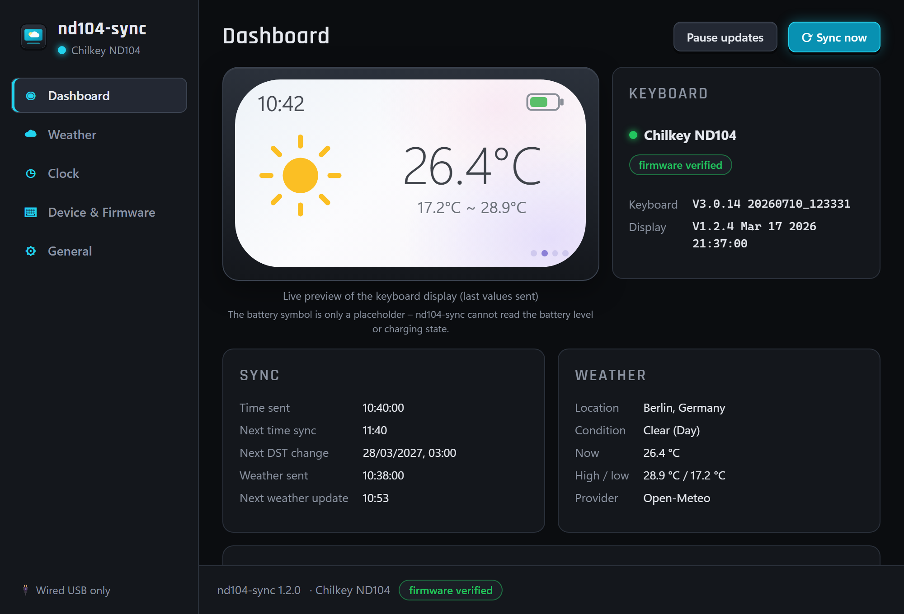
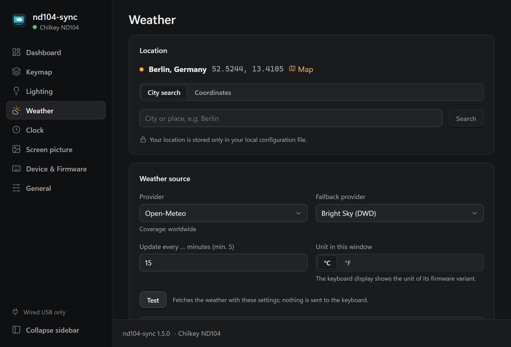
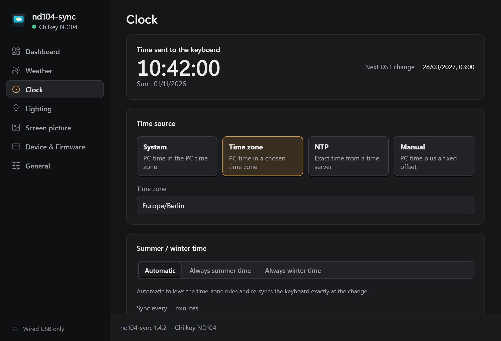
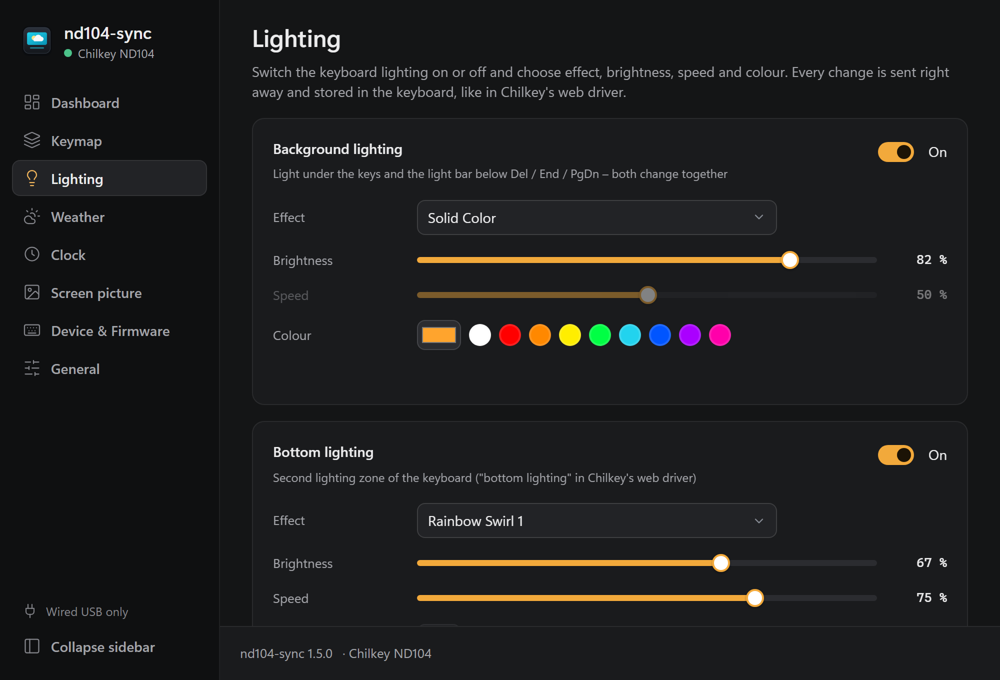
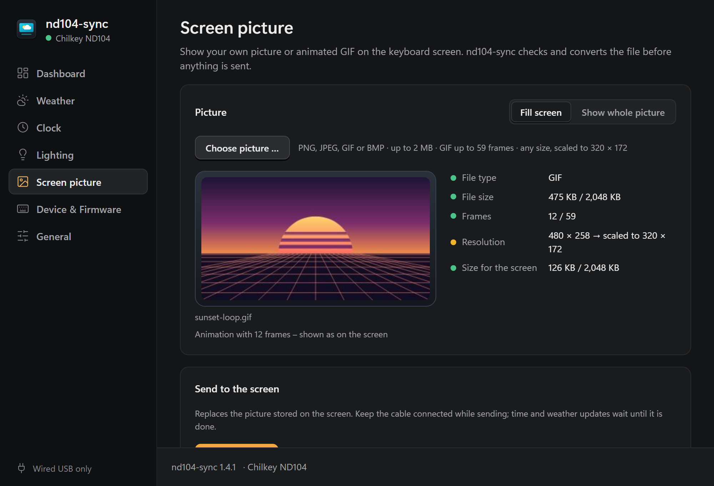
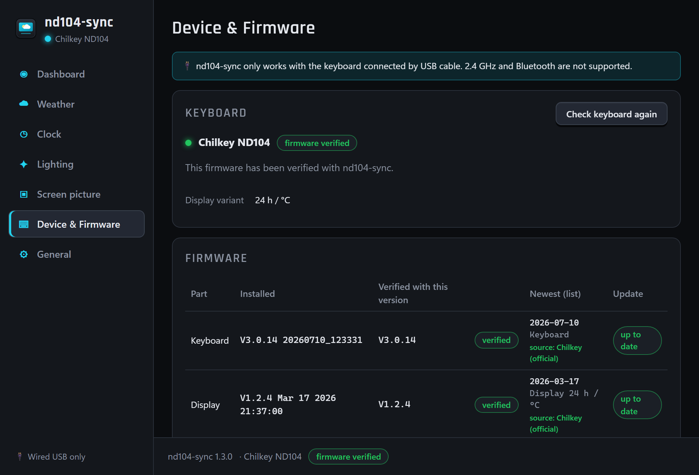
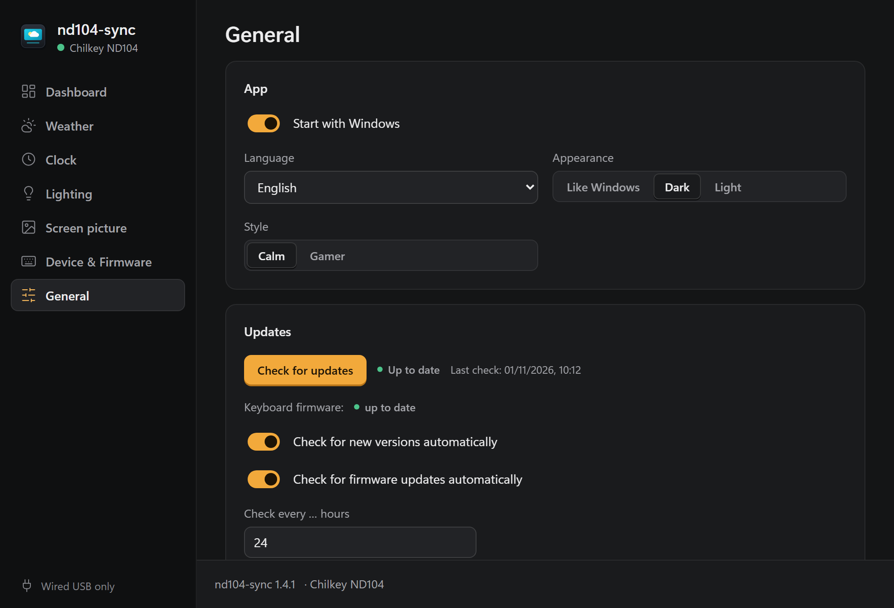

# nd104-sync

[](https://github.com/MrUrdam/chilkey_nd104_utilities/releases)
[](https://github.com/MrUrdam/chilkey_nd104_utilities/actions/workflows/nd104-sync-ci.yml)
[](../../LICENSE)


<br>


Keeps the display of the **Chilkey ND104** keyboard up to date with the
**current time and weather**, and lets you set the **keyboard lighting** and
show **your own picture or GIF** on the screen. A small tray app with a
settings and status window: set it up once, then forget it.

<p align="center">
  
</p>

<table>
  <tr>
    <td align="center"><br><sub>Weather: provider, location search, test</sub></td>
    <td align="center"><br><sub>Clock: source, time zone, summer/winter time</sub></td>
  </tr>
  <tr>
    <td align="center"><br><sub>Lighting: on/off, effect, brightness, speed, colour</sub></td>
    <td align="center"><br><sub>Screen picture: checks, animated preview, send</sub></td>
  </tr>
  <tr>
    <td align="center"><br><sub>Device & Firmware: safety state, update check</sub></td>
    <td align="center"><br><sub>General: autostart, language, theme, style, updates</sub></td>
  </tr>
</table>

**⬇️ [Download the installer](https://github.com/MrUrdam/chilkey_nd104_utilities/releases)** ·
[Installation](#installation) · [Usage](#usage) · [Changelog](CHANGELOG.md)

> ⚠️ **Use at your own risk.** Unofficial hobby project, not affiliated with
> Chilkey. No warranty and no guaranteed support. Only tested with the
> firmware versions listed under [Supported firmware](#supported-firmware),
> on Windows 10/11, with the keyboard connected by **USB cable** (no 2.4 GHz
> dongle, no Bluetooth). Full text: [disclaimer](../../README.md#disclaimer).

---

## Why?

The ND104 has no internet connection. Its display can show time and weather,
but only if a connected PC sends that information. The official solution is a
browser-based driver plus a weather plugin with a fixed weather backend.
nd104-sync replaces this with a small background app that you configure once:
your weather provider, your location, your clock source.

## Features

**Time and weather**
- **Syncs the clock** to the keyboard regularly, on connect, after sleep and
  exactly at summer/winter time changes
- Clock sources: **system time, time zone, NTP or manual offset**, with
  automatic or forced summer/winter time
- **Fetches the weather** for your location and sends current, max and min
  temperature plus a condition icon to the display
- **Five weather providers** (two without API key) with a fallback provider
  and a city search for your location

**Lighting and screen**
- **Lighting:** background and bottom lighting on/off, effect, brightness,
  speed and colour
- **Own picture or GIF** on the screen: any PNG/JPEG/GIF/BMP is checked
  (type, size, frames) and scaled to 320 × 172 before it is sent

**Safety and updates**
- **Firmware safety lock:** works with older/newer firmware too, but stops
  immediately as soon as the protocol behaves differently
  (see [Firmware safety](#firmware-safety))
- **Shows the installed firmware** of keyboard and screen
- **Checks for firmware updates** against Chilkey's official folders and
  notifies you. It never downloads or flashes anything.
- **Checks for new nd104-sync releases** on GitHub (see [Updating](#updating))

**App**
- Starts with Windows and lives in the **system tray**
- **Status dashboard** with a live preview of what the display shows
- API keys stored in the **Windows Credential Manager**
- UI in **English and German** (follows the system language, switchable)
- **Two styles**, "Calm" (default) and "Gamer", each in **dark and light**
  following Windows; both can be changed in settings and in the setup
- **Console runner** `nd104-cli` for scripting and testing
- **No telemetry** (see [Privacy](#privacy--network-access))

## What it does NOT do

- ❌ **No wireless support.** No 2.4 GHz dongle, no Bluetooth. USB cable only.
- ❌ **No Linux / macOS support.** Windows 10/11 only.
- ❌ **No firmware flashing.** It never downloads, installs or modifies firmware.
  It only tells you an update exists.
- ❌ **No risky communication.** Time, weather, lighting and the own picture
  are only sent while every protocol check passes. If anything
  looks different, the tool stops sending immediately and tells you why. There
  is no "ignore and continue" switch.
- ❌ **No keyboard configuration.** Keymap, macros, knob, debounce, sleep
  times etc. stay with the official [Chilkey driver](https://chilkey.com/pages/console).
  Lighting covers on/off, effect, brightness, speed and colour.
- ❌ **No display themes.**
- ❌ **No °C/°F or 12/24 h switching on the display.** Chilkey ships two screen
  firmware variants (24 h + °C, 12 h + °F). The unit and the time format are
  fixed when the firmware is built and cannot be changed or read over USB; the
  keyboard converts the °C values and the 24 h time it receives itself (see
  [docs/firmware.md](../../docs/firmware.md)). The UI unit is independent of it.
- ❌ **No other keyboard models.** Only the Chilkey ND104 is supported. The
  code has a model interface (`KeyboardModel` in
  [`crates/nd104-core/src/model/mod.rs`](crates/nd104-core/src/model/mod.rs)),
  so other keyboards with displays could be added.
- ❌ **Not meant to run alongside** the official Chilkey weather plugin. Both
  would write to the display.

---

## Requirements

| | |
|---|---|
| OS | Windows 10 (21H2+) or Windows 11, 64-bit |
| Connection | Chilkey ND104 via **USB cable** |
| Firmware | Verified versions, or other versions while the protocol checks pass (see below) |
| Runtime | Microsoft Edge WebView2 (pre-installed on Windows 11 and current Windows 10) |

### Supported firmware

| Part | Verified version | Status |
|---|---|---|
| Keyboard | V3.0.14 (`20260710_123331`) | ✅ verified on hardware (2026-10-31) |
| Screen (24 h / °C) | V1.2.4 (`Mar 17 2026 21:37:00`) | ✅ verified on hardware (2026-10-31) |
| Screen (12 h / °F) | – | not verified (runs as "compatible" if all checks pass) |

Other versions run as **compatible (unverified)** as long as every protocol
check passes.

Firmware sources and the newest files: [docs/firmware.md](../../docs/firmware.md).

## Firmware safety

Before sending anything, nd104-sync reads the firmware versions of the keyboard
and of the display, using the same queries as the official web driver (see
[docs/protocol.md § 3](../../docs/protocol.md#3-firmware-version-queries)). It
then compares them with a list of versions it has been verified against.

Older or newer firmware is welcome, but the protocol has to behave exactly as
expected. nd104-sync checks this when the keyboard is connected and on every
write:
- both USB devices have the expected interfaces and report sizes,
- the version queries are answered correctly,
- writes are accepted,
- answers look the way they did on verified firmware.

| Situation | What happens |
|---|---|
| Verified version, all checks pass | **Verified:** normal operation |
| Older/newer version, all checks pass | **Compatible (unverified):** time and weather are synced; you get a one-time notification and the status page shows "unverified firmware" |
| Any check fails (before or during operation) | **Locked:** stops sending immediately. Tray icon turns amber, a notification names the failed check, and the status page explains what to do |
| Version cannot be read | Locked |

A lock is only lifted by re-connecting the keyboard or by
"Check again", and either way all checks run again. There is intentionally
**no "ignore and continue" override**.

Lighting and the own picture use the same checks. They are extras: if the
firmware answers "not supported" or does not answer, the page shows that and
time/weather keep running; a damaged answer locks like everywhere else.

## Firmware update check

Chilkey publishes firmware only as files in public Google Drive folders (the
version text on their support pages is outdated). nd104-sync therefore checks
**Chilkey's official folders directly**: it takes the newest firmware file per
part – keyboard, display 24 h/°C or 12 h/°F – and compares the build date in
its name with the build date your keyboard reports.

**Fallback:** if a folder cannot be read (no network, Google changed the page,
folder moved), the reviewed version list
[`firmware/versions.json`](../../firmware/versions.json) of this repository is
used for that part. The settings window shows the source per part
(*Chilkey (official)* or *repository list*). A GitHub Action keeps that list
up to date: it checks Chilkey's folders every day and opens an issue on
changes ([details](../../firmware/README.md)).

The check runs:
- when the keyboard is first connected, then once a day,
- on **Check for updates** (settings window: General or Device & Firmware –
  the button checks app and firmware together),
- on the console: `nd104-cli firmware-check`.

The **Device & Firmware** page shows per part: installed, newest available
(with source), state (*up to date*, *update available*, *newer than the
newest file*, *unknown*), the download folder and Chilkey's update
instructions. If an update is available
you get a notification once. Updating stays your decision and is done with
Chilkey's tools – **nd104-sync never downloads or flashes firmware**. After an
update, nd104-sync checks the new firmware automatically (verified or
compatible, see [Firmware safety](#firmware-safety)).

The automatic check can be switched off (General → *Check for firmware updates
automatically*, or `[updates] firmware_check = false`).

## Weather providers

| Provider | API key | Coverage | Status |
|---|---|---|---|
| [Open-Meteo](https://open-meteo.com/) (default) | no | worldwide | ✅ available |
| [Bright Sky](https://brightsky.dev/) (DWD data) | no | Germany and nearby | ✅ available |
| [OpenWeatherMap](https://openweathermap.org/) | [free key](https://home.openweathermap.org/users/sign_up) | worldwide | ✅ available |
| [WeatherAPI.com](https://www.weatherapi.com/) | [free key](https://www.weatherapi.com/signup.aspx) | worldwide | ✅ available |
| Manual / Test | – | – | ✅ available |

**Default location:** Berlin, until you pick your own (city search in the
settings, or `nd104-cli geocode "<city>" --set 1`). Your location is stored only
in your local config file, never in this repository.

**Weather icons:** all ten icons of the display are used, including
thunderstorm and the night variants of clear and partly cloudy. Each provider
maps its own codes to one neutral condition, which the keyboard model turns
into the icon (table in [docs/protocol.md § 4.2](../../docs/protocol.md#42-weather-command-0xfe-len-8)).
Open-Meteo and Bright Sky only report "cloudy or overcast"; nd104-sync uses
their cloud cover to choose: below 88 % (7/8) the single cloud, from 88 %
the overcast icon.

Providers are plug-ins implementing one interface (`WeatherProvider` in
[`crates/nd104-core/src/weather/mod.rs`](crates/nd104-core/src/weather/mod.rs)),
so more can be added.

**API keys** (OpenWeatherMap, WeatherAPI.com):
- Enter them in the settings window → **Weather** → *API key – …* → **Save key**,
  or on the console: `nd104-cli api-key set openweathermap` (the key is read
  from the console, not from the command line).
- They are stored in the **Windows Credential Manager** (entry
  `<provider>.nd104-sync`), never in the config file or the log, and are only
  sent to that provider.
- The window shows only *stored / not stored*; a stored key is never displayed
  again. **Test** can check a key before you save it.
- New OpenWeatherMap keys can take up to two hours to become active.

## Clock sources

| Source | Description |
|---|---|
| System (default) | Local PC time in the PC time zone |
| Time zone | PC time converted to a chosen time zone (default: Germany, `Europe/Berlin`) |
| NTP | Time from an NTP server (default `pool.ntp.org`) in the chosen time zone (default: Germany) |
| Manual | PC time plus a fixed offset, PC time zone |

Summer/winter time: **Auto** (from time-zone rules) · force summer · force winter.

---

## Installation

All options need Windows 10/11 (64-bit) and the keyboard connected **by USB
cable**. Releases are published on the
[releases page](https://github.com/MrUrdam/chilkey_nd104_utilities/releases)
(tag `nd104-sync-vX.Y.Z`).
Each release has:

| File | What | When to use |
|---|---|---|
| `nd104-sync_X.Y.Z_x64-setup.exe` | **Setup (recommended)** – install, update and uninstall; per user, no admin rights, English/German | normal use |
| `nd104-sync_X.Y.Z_x64_en-US.msi` | MSI installer – per machine, needs admin rights | managed PCs, software deployment |
| `nd104-sync-X.Y.Z-windows-x64.zip` | Portable: `nd104-sync.exe` (tray app), `nd104-cli.exe`, `nd104-probe.exe` | no installation, testing |
| `SHA256SUMS.txt` | Checksums of all files | verifying downloads |

### Option A – installer (recommended)

1. Download `nd104-sync_X.Y.Z_x64-setup.exe` from the newest release.
2. Optional: compare its checksum with `SHA256SUMS.txt`:
   `certutil -hashfile nd104-sync_X.Y.Z_x64-setup.exe SHA256`
3. Run it. The setup is not code-signed, so Windows SmartScreen may warn:
   **More info → Run anyway**.
4. Choose whether nd104-sync starts with Windows (on by default) and whether
   you want a desktop shortcut (off by default), then **Install**. A progress
   bar shows the installation; no admin rights are needed. nd104-sync is
   installed to `%LOCALAPPDATA%\Programs\nd104-sync` and gets a Start menu
   entry and an entry in Windows **Apps**.
5. **Start nd104-sync**. Its icon appears in the tray (maybe behind the **^**
   arrow; drag it onto the taskbar to keep it visible). The last page of the
   setup also tells you whether your keyboard is connected by cable.
6. The settings window opens on first start: **Weather → Location** → search
   your city, check it on the map (🗺) if needed, pick it, **Apply**. Without
   this, Berlin is used.

If the Microsoft Edge WebView2 Runtime is missing (rare: it ships with
Windows 11 and current Windows 10), the setup offers to download and install
it from Microsoft first.

Unattended installation: `nd104-sync_X.Y.Z_x64-setup.exe --silent`
(add `--no-autostart` and/or `--desktop-shortcut`). The exit code is 0 on
success.

Installed nd104-sync 1.0.x with the old installer? The new setup takes over
that installation: it moves nd104-sync to the new folder and keeps your
settings, API keys, logs and the "Start with Windows" choice.

### Option B – portable zip

1. Download and extract `nd104-sync-X.Y.Z-windows-x64.zip`, e.g. to
   `%LOCALAPPDATA%\Programs\nd104-sync`.
2. Start `nd104-sync.exe` (tray app) – it enables "Start with Windows" for
   the exe at this location – or use the console runner `nd104-cli.exe`.

### Option C – your own build

1. [Build from source](#building-from-source).
2. Run `target/release/nd104-sync-setup.exe` (the setup with your build
   inside), or run `target/release/nd104-sync.exe` directly.

In every case the configuration lives in `%APPDATA%\nd104-sync\config.toml`
and the logs in `%LOCALAPPDATA%\nd104-sync\logs` – see [Files](#files).

### Uninstall

Windows Settings → **Apps** → nd104-sync → **Uninstall**. The setup closes
nd104-sync if it is running and removes the app, its shortcuts and the
autostart entry. **Keep my settings** is ticked by default: your
configuration, location and API keys stay for a later installation. Untick it
to delete the settings, the stored API keys and the logs as well.

Unattended: `"%LOCALAPPDATA%\Programs\nd104-sync\nd104-sync-setup.exe" --uninstall --silent`
(add `--remove-settings` to delete the settings too).

MSI installation: uninstall it in Windows **Apps** as usual; the configuration
and logs are kept. For the portable zip, untick "Start with Windows" first,
then delete the folder.

## Updating

**Update check:** nd104-sync asks GitHub for the newest release 30 seconds
after start and then once a day. If a newer version exists, you get a
notification. Nothing is downloaded or installed automatically. Check by
hand:
- Settings window → General → **Check for updates** (always shows a result)
- Console: `nd104-cli check-update`

Only releases tagged `nd104-sync-vX.Y.Z` count; drafts and pre-releases are
ignored.

**How to update:**
- **Setup, one click:** settings window → General → **Install update**.
  nd104-sync downloads the new setup, checks it against the release's
  `SHA256SUMS.txt`, closes itself and shows a small progress window; it starts
  again on its own when the update is done.
- **Setup, by hand:** download the new `…-setup.exe` and run it. It recognises
  the installed version and offers **Update** (it closes nd104-sync for you).
  Configuration, location and API keys stay. Running an *older* setup works
  too – it shows a hint and installs that version on request.
- **MSI:** run the new `.msi`; it upgrades the installed version.
- **Portable zip:** quit nd104-sync, replace the files in your folder.
- **Own build:** `git pull`, build again, install or replace the exe.

Configuration files are versioned (`schema = 1`). A newer app migrates older
files automatically. An older app refuses a file written by a newer schema
instead of misreading it.

## Versioning

- nd104-sync uses [Semantic Versioning](https://semver.org/): `MAJOR.MINOR.PATCH`.
  MAJOR = incompatible changes, MINOR = new features, PATCH = fixes.
- **One source of truth:** `version` in [`Cargo.toml`](Cargo.toml)
  (`[workspace.package]`). Every crate, the CLI (`nd104-cli --version`) and the
  app UI read it from there.
- **Release tags:** `nd104-sync-vX.Y.Z`. The prefix is needed because this
  repository hosts several tools.
- **Changes:** listed per version in [CHANGELOG.md](CHANGELOG.md).
- **Where the version is shown:** settings window (General → About), dashboard
  footer, tray tooltip, `nd104-cli --version`, and the first line of each log file.

## Usage

1. Connect the ND104 with a **USB cable**.
2. Close the official Chilkey web driver / weather plugin.
3. Start nd104-sync (Start menu, or automatically with Windows). The tray icon
   appears and time and weather are sent right away.
4. Set your location once in the settings window (Weather → Location).

**Tray menu**

| Entry | Action |
|---|---|
| Status line | Keyboard, weather and state at a glance |
| Sync now | Send time and weather immediately (fetches fresh weather) |
| Pause / Resume updates | Stop / resume all updates |
| Settings… | Opens the settings window |
| Start with Windows | Autostart on/off |
| Quit | Exit the app |

Everything else is in the settings window: **Check for updates** (app and
firmware), **language**, **Check keyboard again** (Device & Firmware), **log
folder** and **About** with the version (General).

**Tray icon colours:** cyan = connected & synced · grey = not connected ·
amber = locked (protocol check failed) · red = weather stale.
The **tooltip** shows the app version, keyboard, weather and the last sync.

**Notifications:** keyboard locked, unverified firmware detected, new
nd104-sync version available, new keyboard firmware available, result of a
manual update check.

### Settings window

Opens via tray → **Settings…**, on first start, when nd104-sync is started a
second time, or with `nd104-sync.exe --settings`. Closing it keeps the app
running in the tray.

| Page | Contents |
|---|---|
| **Dashboard** | Large live preview of the keyboard display with keyboard state and last/next syncs (incl. next DST change) next to it; weather, firmware, recent events; Sync now, Pause/Resume |
| **Weather** | Location via city search (with OpenStreetMap link to check a result) or coordinates; provider, fallback, interval, °C/°F in the window; Test button (fetches without sending) |
| **Clock** | Source (System / Time zone / NTP / Manual), time zone, NTP test, summer/winter time mode, sync interval; live preview of the time sent |
| **Lighting** | Background lighting (keys + light bar below Ins/Home/PgUp) and bottom lighting: on/off, effect, brightness, speed, colour (sent and stored right away) |
| **Screen picture** | Choose a picture or GIF, see the checks and a preview (fill the screen or show the whole picture), send it to the screen with a progress bar |
| **Device & Firmware** | Verified / unverified / locked state, installed vs. verified firmware, display variant, Check keyboard again, polling interval |
| **General** | Start with Windows, language, appearance (like Windows / dark / light), style (Calm / Gamer), update check, About with version, config file and log folder |

Changes take effect with **Apply** (shown only when something changed);
invalid fields are marked. The configuration file can still be edited by hand –
changes are picked up within seconds.

### Console runner `nd104-cli`

Runs the same core on the console – useful for testing and for setting the
location. It uses the same configuration file as the app. Do not run it at the
same time as the tray app (both would send to the keyboard).

```
nd104-cli                            # run continuously (= nd104-cli run), Ctrl+C to stop
nd104-cli status                     # keyboard, firmware, protocol check result
nd104-cli sync                       # send time + weather once, then exit
nd104-cli geocode "Berlin"           # search a city
nd104-cli geocode "Berlin" --set 1   # store result 1 as your location
nd104-cli weather                    # fetch and print the weather (nothing sent)
nd104-cli check-update               # check GitHub for a newer release
nd104-cli firmware-check             # compare keyboard firmware with the version list
nd104-cli api-key status             # which providers have a stored key
nd104-cli api-key set <provider>     # store a key (prompted, not on the command line)
nd104-cli api-key delete <provider>  # delete a key
nd104-cli config path|show|init      # where the config is / print it / create it
nd104-cli --config other.toml …      # use another config file
nd104-cli --version
```

Set `RUST_LOG=debug` for more output.

### App command-line options

```
nd104-sync.exe                # normal start (tray)
nd104-sync.exe --minimized    # used by autostart (tray only)
nd104-sync.exe --settings     # open the settings window right away
```

### Files

| What | Where |
|---|---|
| Configuration | `%APPDATA%\nd104-sync\config.toml` |
| Logs | `%LOCALAPPDATA%\nd104-sync\logs\` |
| API keys | Windows Credential Manager (`nd104-sync/<provider>`) |
| Program (setup) | `%LOCALAPPDATA%\Programs\nd104-sync\` (includes `nd104-sync-setup.exe` for uninstalling) |

## Privacy / network access

nd104-sync connects only to:
- the weather provider you selected, plus the fallback provider if the first
  one fails (and Open-Meteo geocoding for city search) – API keys are sent only
  to their own provider,
- the NTP server, if you selected NTP as clock source,
- Chilkey's public Google Drive firmware folders (`drive.google.com`) and, as
  a fallback, the version list in this repository (`raw.githubusercontent.com`)
  for the firmware update check – can be disabled,
- the GitHub releases API of this repo for the app update check – can be disabled
  (`[updates] app_check = false`).

No telemetry, no analytics, no IP-based location unless you turn it on.

## Troubleshooting

| Problem | Fix |
|---|---|
| "Not connected" | Use a USB **cable** (wireless is not supported); try another port; avoid unpowered hubs |
| Amber icon / locked | A protocol check failed (the reason is in the tray status line, the notification and the log). Re-connect the cable or use "Check keyboard again"; if it stays locked, your firmware behaves differently – please open an issue with the log |
| No tray icon | It may be hidden behind the **^** arrow in the taskbar; drag it out. Is nd104-sync running (Task Manager)? |
| SmartScreen blocks the setup | The setup is not code-signed: **More info → Run anyway** |
| "Install update" is missing | It is offered only for installations made by the setup (1.1.0+). With the MSI or the zip, download the new version from the release page |
| Config or log folder "not available" / settings not found | nd104-sync was started from a packaged (MSIX) app, e.g. some terminals or IDE integrations; Windows then redirects its AppData into that app's package folder (`%LOCALAPPDATA%\Packages\<app>\LocalCache\…`). Start nd104-sync from the Start menu or via autostart instead |
| Tray app and `nd104-cli run` at the same time | Only run one of them |
| Display shows other values | The official Chilkey weather plugin is probably still running – close it |
| Wrong time after DST change | Check time zone / DST mode in the Clock tab |

---

## Building from source

### Prerequisites (Windows)

| Tool | Version | Needed for | Notes |
|---|---|---|---|
| [Rust](https://rustup.rs/) | stable, `x86_64-pc-windows-msvc` | everything | install with `rustup-init.exe`, default options |
| Visual Studio Build Tools | 2022 | everything | workload **"Desktop development with C++"** (linker) |
| [Git](https://git-scm.com/) | any | getting the code | |
| [Node.js](https://nodejs.org/) | LTS (≥ 20) | settings window, Tauri CLI | the Tauri CLI comes via npm |
| WebView2 Runtime | current | app | pre-installed on Windows 10/11 |

Quick install with winget (Rust, then the Build Tools with the C++ workload):

```bash
winget install --id Rustlang.Rustup -e
```

```bash
winget install --id Microsoft.VisualStudio.2022.BuildTools -e --override "--passive --wait --norestart --add Microsoft.VisualStudio.Workload.VCTools --includeRecommended"
```

### Build

```bash
git clone https://github.com/MrUrdam/chilkey_nd104_utilities.git
cd chilkey_nd104_utilities/apps/nd104-sync
npm ci                     # frontend + Tauri CLI
npm run build              # settings window → ui/dist (embedded into the app)
npm run build:installer-ui # setup window → installer-ui/dist (embedded into the setup)
cargo test --workspace     # unit tests, no hardware needed
cargo build --release --workspace --exclude nd104-sync-setup
                           # → target/release/nd104-sync.exe, nd104-cli.exe, nd104-probe.exe
npm run tauri build        # app + MSI → target/release/bundle/msi/*.msi
cargo build --release -p nd104-sync-setup
                           # setup with the app inside → target/release/nd104-sync-setup.exe
```

- `npm run build` must run before any `cargo build` of the app, because the
  window's files are compiled into `nd104-sync.exe`.
- The setup (`installer/`) packs `target/release/nd104-sync.exe`, the console
  tools and the docs into itself, so build it **last**. Built without the app
  it shows its window but refuses to install.
- `npm run tauri build` downloads WiX on first use.
- Development with hot reload: `npm run tauri dev`.
- Frontend type check: `npm run check`.

### Making a release (maintainers)

Stable releases follow SemVer (MAJOR.MINOR.PATCH); pre-releases use `X.Y.Z-rc.N`.

1. Set the version in `Cargo.toml` (`[workspace.package] version`) and run
   `cargo build` so `Cargo.lock` follows.
2. In [CHANGELOG.md](CHANGELOG.md), move the `[Unreleased]` entries into a new
   section `## [X.Y.Z] – YYYY-MM-DD` and add the link at the bottom.
3. Commit, then tag and push:
   `git tag nd104-sync-vX.Y.Z` and `git push origin nd104-sync-vX.Y.Z`.
4. The workflow [`nd104-sync-release.yml`](../../.github/workflows/nd104-sync-release.yml)
   checks that the tag matches `Cargo.toml`, runs the tests, builds the
   console tools, the tray app and the **MSI**, then the **setup**, packs
   the portable zip, writes `SHA256SUMS.txt` and publishes the GitHub release.
   Its notes are the CHANGELOG section for that version plus a download list.
   - `X.Y.Z-rc.N` → GitHub pre-release without MSI (WiX needs a plain version),
     ignored by the app update check.

Every push to `main` also runs [`nd104-sync-ci.yml`](../../.github/workflows/nd104-sync-ci.yml):
frontend type check and build, Rust format check, clippy (warnings are errors)
and tests.

### Main dependencies

| Crate / package | Purpose |
|---|---|
| `tauri` v2 + plugins `autostart`, `single-instance`, `notification` | App shell, tray, window |
| `hidapi` | USB HID communication |
| `tokio` | Async runtime, scheduler |
| `reqwest` (rustls) | HTTP for weather / geocoding / manifest |
| `jiff` | Time zones and DST |
| (own SNTP client) | NTP time source, no extra dependency |
| `serde`, `toml`, `directories` | Configuration |
| `keyring` 3 | API keys in the Windows Credential Manager |
| `tracing`, `tracing-appender` | Logging |
| `sys-locale` | System language detection |
| `zip`, `winreg`, `windows` | Setup: embedded app files, Windows "Apps" entry, shortcuts |
| `sha2` | Checking the downloaded setup ("Install update") |
| Svelte 5 + TypeScript + Vite | Settings window (`ui/`) |
| `@tauri-apps/api`, `@tauri-apps/cli` | Window ↔ app calls, build tooling |
| `@fontsource/rajdhani` | Display font, bundled locally (OFL) |

### Project structure

```
apps/nd104-sync/
├── crates/
│   ├── nd104-protocol/   # packet building, CRC (pure, unit tested)
│   ├── nd104-probe/      # diagnostic CLI for hardware tests
│   ├── nd104-core/       # model interface, device + firmware guard,
│   │                     # clock, weather, scheduler, config, update check
│   └── nd104-cli/        # console runner for the core
├── src-tauri/            # Tauri tray app, icons, MSI config
├── ui/                   # Svelte settings window
├── installer/            # setup: install, update, uninstall (Tauri, own window)
├── installer-ui/         # Svelte setup window
└── locales/              # en.json, de.json (the setup has its own in installer/locales)
```

## Contributing

- **New weather provider:** implement the `WeatherProvider` trait, register it,
  add locale strings and a row in the provider table above.
- **New language:** add `locales/<code>.json` with all keys of `en.json`.
- **New platform (Linux/macOS):** not implemented. Please open an issue
  first to discuss it.
- **New firmware version:** verify the protocol on real hardware, document it in
  `docs/protocol.md`, add it to the verified list.

Contributions are welcome, but reviews and answers happen in my free time.
There is no guaranteed support (see the [disclaimer](../../README.md#disclaimer)).

## Credits

Protocol knowledge is based on the
[ND104 reverse engineering notes](https://gist.github.com/borrougagnou/a21613093f323a05167a92212ab1ff7b)
by borrougagnou and on an analysis of the official
[Chilkey web driver](https://nd104.chilkey.com/). Everything is collected in
[docs/protocol.md](../../docs/protocol.md). Inspired by
[zoom-sync](https://github.com/ozboar/zoom-sync).

Unofficial project, not affiliated with Chilkey. Use at your own risk, see the
[disclaimer](../../README.md#disclaimer). MIT licensed, see [LICENSE](../../LICENSE).
